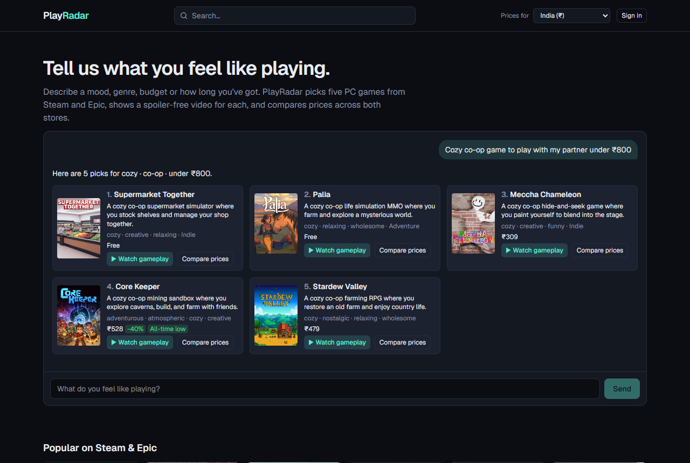
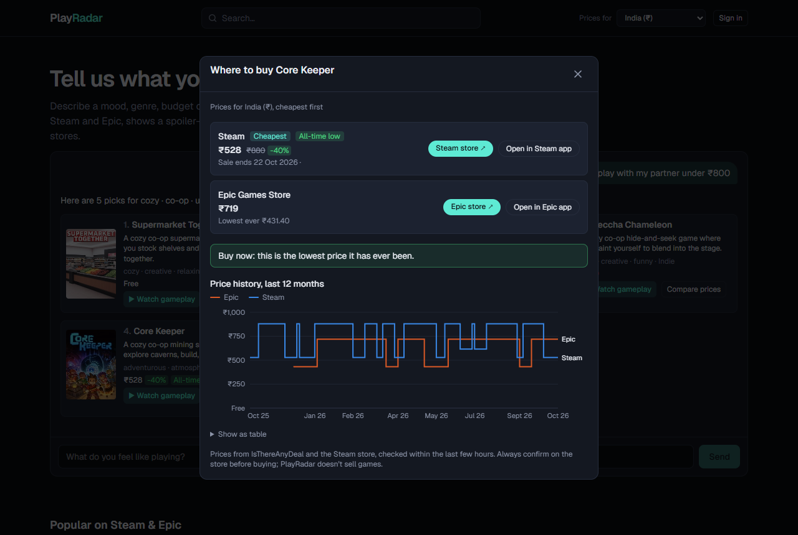
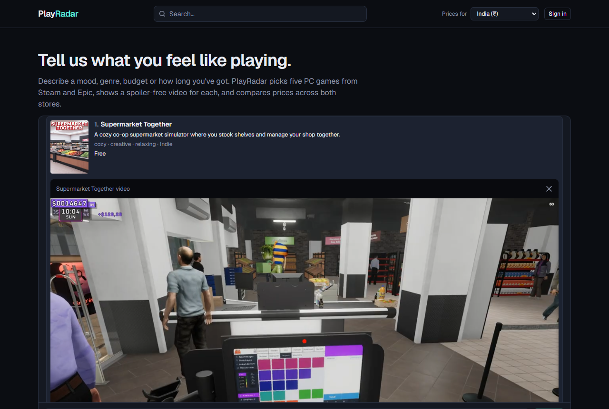
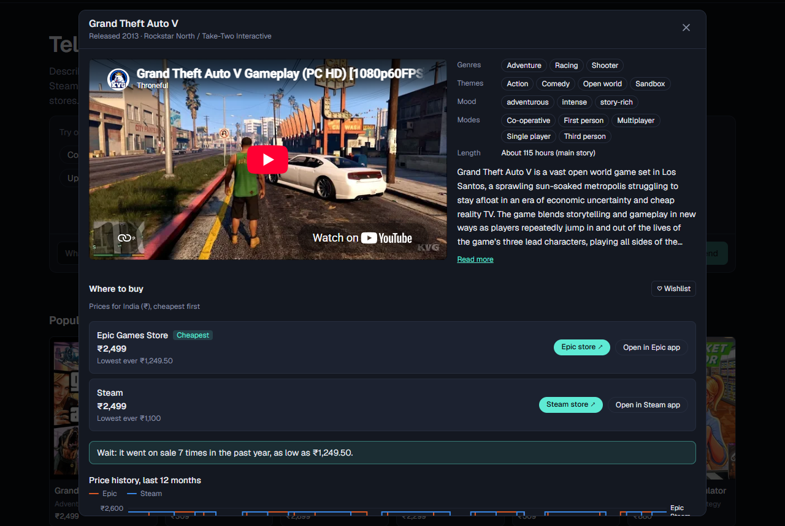
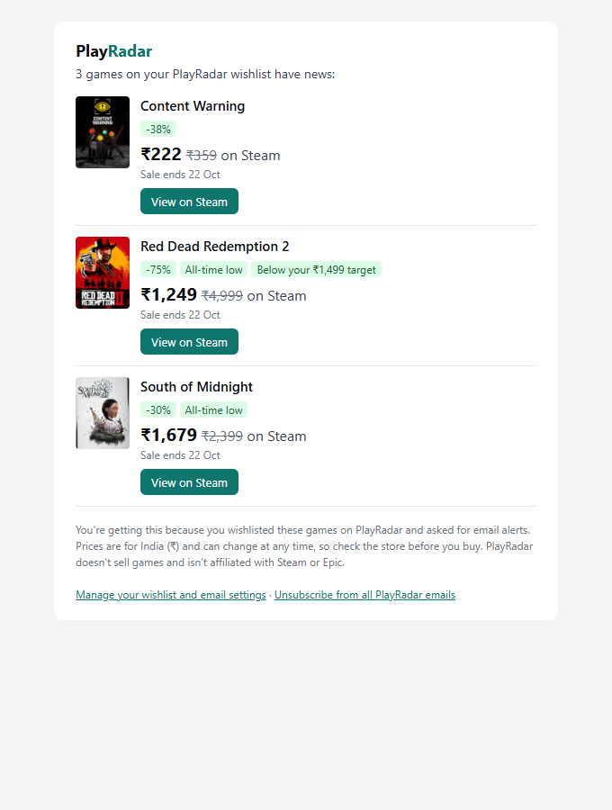
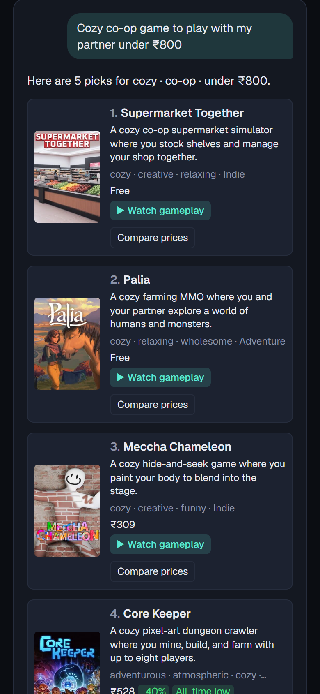
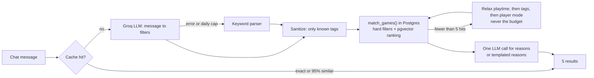

# PlayRadar

**Chat to find your next PC game, watch a spoiler-free video, and get price alerts that show the actual price.**

Live: **https://play-radar-ten.vercel.app**

PlayRadar covers Steam and the Epic Games Store. You describe what you feel like playing, and an LLM turns that into search filters. The games come only from PlayRadar's own catalog of about 2,000 titles, so the model never makes up a game. Each pick comes with a gameplay video chosen to avoid spoilers, a Steam vs Epic price comparison with 12 months of history, and a wishlist whose alert emails put the real price in the subject line. Steam's and Epic's own wishlist emails only say a game is on sale.

It is a solo, zero-budget project: everything runs on free tiers, and every external service has a non-AI / non-API fallback.



## Features

- **Conversational search.** "Cozy co-op game to play with my partner under ₹800" becomes tags, player mode, budget and playtime filters, then a hybrid ranking (vector similarity + tag overlap + your past feedback + popularity). Follow-ups refine the previous turn ("cheaper", "no horror").
- **No hallucinated games.** The LLM only produces filters and one-line reasons; the games always come from the database.
- **Spoiler-free videos.** Rules pick an 8–15 minute gameplay overview and reject walkthroughs, endings, boss fights, challenge videos and the like. Borderline cases go to an LLM. Hand-checked on a 50-game set (see [Results](#results)).
- **Prices in four regions** (India, US, UK, Europe), stored in native currency, never converted. You get cheapest-first store cards, the all-time low, a price-history chart and a "wait or buy?" hint based on how often the game went on sale this year.
- **Wishlist alerts by email** for any sale, an all-time low, a target price or a release, sent instantly or as a daily or weekly digest. You also get Epic free-game alerts. Each alert is sent once, with a one-click unsubscribe.
- **Works without an account**, with daily limits. Sign-in is a passwordless magic link, and you can delete your account in one click.
- **Public metrics page**, [/metrics](https://play-radar-ten.vercel.app/metrics): click-through rate, LLM vs fallback answers, cache hits, video accuracy and today's free-tier usage.

| Price comparison and history | Video in a result |
|---|---|
|  |  |
| **Game details** | **Alert email** (real template; prices from the live catalog, wishlist sample data) |
|  |  |

<p align="center"></p>

## How it works



- **Retrieval** is a single SQL function, `match_games`. It applies hard filters (tags, player mode, budget in the user's region, playtime, release status, games the user said "not for me" to), then ranks by `0.6·vector similarity + 0.3·tag overlap + 0.03·your tag affinity + 0.05·popularity`. Embeddings use `gte-small` (384 dimensions). Catalog vectors are computed offline, and query vectors come from a Supabase Edge Function running the same model.
- **The LLM work is split by role across three Groq models** (filters, reasons, heavy batch jobs). Groq's free quota is per model, so the split triples it. Every LLM call has a daily cap enforced in Postgres and a non-LLM fallback.
- **Videos are chosen lazily**, only when someone presses Watch or opens a game, and cached forever. A YouTube search costs 100 of the 10,000 daily units, so picking videos for all five results up front would burn the quota. Upcoming games use their official IGDB trailer, which costs 1 unit.
- **Prices** come from IsThereAnyDeal. Where ITAD has no Steam price (about 6% of games, e.g. Skyrim), the Steam storefront API fills the gap. A snapshot is stored only when the price changes. The 12-month history is backfilled lazily, the first time someone opens the price popup or wishlists the game.
- **Alerts are state-based.** An alert's "episode" is the run of snapshots where its condition holds (on sale, at the all-time low, at or below your target). It fires once per episode, and only for episodes that started after you wishlisted the game. Emails are re-checked just before sending, so a sale that ended in the meantime is dropped.
- **Scheduled jobs** run on GitHub Actions:

  | Workflow | When (UTC) | What it does |
  |---|---|---|
  | `prices.yml` | every 4 h | Prices for wishlisted games, then instant alerts |
  | `daily.yml` | 21:30 | Whole-catalog prices in all 4 regions, release dates, alerts, housekeeping |
  | `digests.yml` | 03:30 | Daily digest (and weekly on Mondays) |
  | `epic-free.yml` | 16:40 | Epic giveaways (adds missing games to the catalog), free-game alerts, mood tags and embeddings for new games |

## Results

**Spoiler-free video selection, checked by hand on 50 games** (a fixed pseudo-random sample of the 1,500 most popular, with 42 released and 8 upcoming). Each selected video was watched and marked good or not good on an owner-only labelling page.

| Round | Correct | Notes |
|---|---|---|
| 1, before any tuning | **41 / 50 (82%)** | 41/48 (85%) of the games that got a video. All 14 official trailers were right |
| 2, after tuning on these misses | _pending_ | Labelling of the 7 re-selected videos in progress |

Round 1 broken down by how the video was chosen:

| Chosen by | Correct |
|---|---|
| Rules alone (score ≥ 6) | 13 / 14 |
| LLM yes/no on borderline videos | 11 / 15 |
| IGDB "gameplay" video | 3 / 5 |
| Official trailer | 14 / 14 |
| No suitable video found | 0 / 2 |

What the misses taught us, and what changed (each is now an offline test case in `scripts/check-video-rules.ts`):

- **IGDB's video labels can't be trusted.** A video IGDB called "Gameplay" was a 110-minute playthrough, and another was a tournament match. IGDB videos are now checked by their real YouTube title and length.
- **The LLM was the weakest judge.** It approved a framerate test, an overview of one character, a "new releases" roundup and a Portuguese review. Those patterns are now rules (and listed in its prompt).
- **One miss slipped past the rules**: a gold-farming guide. Guides, builds and benchmarks are now rejected.
- **The new rules were simulated on all stored videos before shipping.** None of the 41 good videos would be rejected, and the simulation found a full 11-hour walkthrough on a popular game outside the eval set.

Round 1 is kept in [`lib/video/evalRound1.json`](lib/video/evalRound1.json). Round 2 is measured on the same 50 games the rules were tuned on, so it is an optimistic number. Round 1 is the honest one.

**Catalog and data** (October 2026): 1,995 games (293 upcoming) with 1,983 Steam and 692 Epic listings. 1,644 games have a current price, and 10,000+ price snapshots are stored across the four regions. 95 tags, including LLM-generated moods and sub-genres players search for (Soulslike, Metroidvania, Roguelike…).

**Usage.** Live traffic so far is small, a few dozen chat turns, mostly from testing. [/metrics](https://play-radar-ten.vercel.app/metrics) shows the live numbers, and [`sql/report.sql`](sql/report.sql) has the same queries for the database console. One thing they caught: about 1 in 7 LLM answers was being rejected over `null` fields and silently answered by the keyword parser. That is fixed now.

**Free-tier budgets**, each enforced in code with headroom below the provider limit:

| Service | Free limit | PlayRadar cap |
|---|---|---|
| Groq (per model) | ~1,000 requests/day, 8K tokens/min | 900 filter + 900 reason + 600 batch calls/day; guests 10 and accounts 30 chat turns/day |
| YouTube Data API | 10,000 units/day | 9,000 units/day; each game's video is chosen once and cached |
| Brevo email | 300/day (shared with sign-in emails) | 200 alert emails/day; the rest wait in the queue |
| Supabase | 500 MB database | Daily housekeeping: guest chats after 90 days, expired cache and counters |
| IsThereAnyDeal | 1,000 requests / 5 min | Batched 200 games per request |
| GitHub Actions | Unlimited for public repos | 4 scheduled workflows |

## Tech stack

Next.js 15 (App Router) · TypeScript · Tailwind CSS 4 · Recharts · Postgres on Supabase with pgvector and row-level security · Supabase Auth and an Edge Function for embeddings · Groq (gpt-oss-20b, Qwen, gpt-oss-120b) · `@huggingface/transformers` for offline embeddings · IGDB · IsThereAnyDeal · YouTube Data API · Brevo · Vercel (Mumbai region, next to the database) · GitHub Actions.

The server talks to Postgres directly with `pg` (supabase-js is only for auth). Every table has row-level security with no policies, so only the server can read or write.

## Running it locally

```bash
npm install
cp .env.example .env.local      # fill in the keys (all free tiers)
npx supabase db push --db-url "$DATABASE_URL"
npx supabase functions deploy embed --no-verify-jwt --project-ref <ref> --use-api

# Build the catalog (re-runnable), in this order:
npx tsx scripts/seed-igdb.ts
npx tsx scripts/jobs/refresh-catalog-prices.ts
npx tsx scripts/rescue-editions.ts --dry      # then without --dry
npx tsx scripts/dedupe-editions.ts --dry      # then without --dry
npx tsx scripts/add-epic-listings.ts
npx tsx scripts/mood-tags.ts
npx tsx scripts/embed-catalog.ts

npm run dev
```

Offline checks (no API calls): `check-fallback`, `check-video-rules`, `check-hint`, `check-alerts` and `check-epic-free` in `scripts/`, each run with `npx tsx`. CI runs `npm run lint` and `npx tsc --noEmit`.

To try the no-LLM path, start a second server with a broken key: `GROQ_API_KEY=invalid npx next dev -p 3101`.

## Limitations

- Steam and Epic only, PC only, four price regions.
- Search has no typo tolerance.
- Free Epic games such as Fortnite show "Price unavailable", because IsThereAnyDeal doesn't list them.
- GitHub sometimes delays or skips scheduled runs when it's busy, so alerts can arrive hours late.
- Older games can have no suitable video: their trailers are often not embeddable and search results are mostly playthroughs.

## Credits

Game data from [IGDB](https://www.igdb.com). Prices from [IsThereAnyDeal](https://isthereanydeal.com) and the Steam store. Videos from YouTube. PlayRadar is not affiliated with Valve, Steam, Epic Games or the Epic Games Store; game names and covers belong to their owners.
